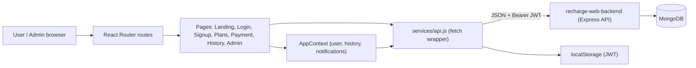

# Recharge Web – Frontend

A React and Tailwind CSS single-page app for prepaid mobile recharges: browse plans, recharge a number, view your history, and manage plans as an admin.


## Overview

This project is one half of a full-stack mobile recharge application, split across two repositories:

| Repository | Role |
|---|---|
| **recharge-web-frontend** (this repo) | React single-page app: landing page, auth, plans, payment, history, admin dashboard |
| [recharge-web-backend](https://github.com/suriyaprakash-25/recharge-web-backend) | Node.js / Express / MongoDB REST API: accounts, JWT auth, plans, recharges, admin data |

The app recreates the flow of a telecom operator's online recharge portal. The UI is themed after Airtel (brand colours and naming), but it is a learning project with no affiliation to any operator. It was built to practise core React concepts (components and props, `useState`, the Context API, routing, form validation) together with Tailwind CSS, and then connected to a real backend. The original requirement checklists are kept in [`PROJECT_DOCUMENTATION.md`](PROJECT_DOCUMENTATION.md) and [`TASK_COMPLETION.md`](TASK_COMPLETION.md); they describe an earlier, modal-based version of the UI.

> Payments are **simulated**. The payment form validates UPI or card details, but no gateway is called; the backend records the recharge as successful.

## Key features

- **Landing page** with an auto-rotating image carousel, feature sections and calls to action.
- **Sign up and log in** with phone number and password, validated with React Hook Form and Yup (10-digit phone number, password of at least 6 characters, name letters only). After login, admins are redirected to `/admin` and users to `/plans`.
- **Plans page**: fetches plans from the backend and shows them in **Individual** and **Family** tabs.
- **Payment page**: receives the selected plan through router state; choose UPI, card or wallet; per-method validation (UPI ID format, 16-digit card number, MM/YY expiry, 3–4 digit CVV). Only the last four card digits are sent to the backend. Guests can complete the flow but nothing is saved.
- **Recharge history** for logged-in users, loaded from the backend.
- **Admin dashboard** (role `ADMIN`) with three tabs:
  - *Dashboard*: totals for users, recharges, revenue and last-30-day recharges, plus Recharts pie, bar and line charts (recharges and revenue by payment method, revenue over time).
  - *Plans*: create, edit and delete plans, including inline editing of name and price.
  - *Users*: list of registered users with roles.
- **Global state** in `AppContext`: user session, recharge history, toast notifications (auto-dismiss after 5 seconds), a light/dark theme flag and a cart helper.

## Architecture



| Component | Responsibility |
|---|---|
| [`src/main.jsx`](src/main.jsx) | Mounts the app inside `AppProvider`. |
| [`src/App.jsx`](src/App.jsx) | Declares routes (`/`, `/login`, `/signup`, `/plans`, `/payment`, `/history`, `/admin`) and renders the global `Notification` component. |
| [`src/context/AppContext.jsx`](src/context/AppContext.jsx) | Global state and actions: `signup`, `login`, `logout`, `addRecharge`, `fetchRechargeHistory`, notifications, theme and cart. |
| [`src/services/api.js`](src/services/api.js) | Thin `fetch` client grouped into `authAPI`, `rechargeAPI`, `plansAPI` and `adminAPI`. Stores the JWT in `localStorage` and attaches it as a `Bearer` header. |
| [`src/pages/`](src/pages) | One component per route; most UI lives here. |
| [`src/components/`](src/components) | `Notification` (used globally) plus earlier reusable components (`Navbar`, `Sidebar`, `Hero`, `PlanCard`, `RechargeForm`, `LoginModal`, `Footer`) from the first version of the UI. |

## How it works

1. **Sign up / log in**: the form is validated client-side, then `authAPI` calls `POST /auth/register` or `POST /auth/login`. The returned JWT goes into `localStorage`; the user profile and role go into `AppContext`.
2. **Choose a plan**: `/plans` calls `GET /plans` and filters by `category`. Selecting a plan navigates to `/payment` with the plan in router state.
3. **Pay**: the payment form switches its Yup schema based on the chosen method. On submit, a logged-in user's recharge is sent to `POST /recharge` with the plan details, target number and masked payment details. A success toast appears and the app returns to `/plans` after two seconds.
4. **History**: `/history` calls `GET /recharge/history` and lists past recharges.
5. **Admin**: `/admin` checks `user.role === "ADMIN"`, then loads `/admin/users`, `/admin/plans` and `/admin/recharges` in parallel and computes totals and chart data in the browser. Plan edits call `POST`, `PUT` or `DELETE /admin/plans`.

## Tech stack

| Layer | Technologies |
|---|---|
| UI | React 19, React Router 7 |
| Styling | Tailwind CSS 3 (custom `airtel` colour palette), PostCSS, Autoprefixer |
| Forms | React Hook Form, Yup, @hookform/resolvers |
| Charts and icons | Recharts, lucide-react |
| State | React Context API and hooks |
| HTTP | Native `fetch` |
| Tooling | Vite 7, ESLint 9 |
| Backend | [recharge-web-backend](https://github.com/suriyaprakash-25/recharge-web-backend) (Express, MongoDB, JWT) |

## Project structure

```
recharge-web-frontend/
├── index.html
├── tailwind.config.js           # Custom airtel colours and font stack
├── vite.config.js
├── PROJECT_DOCUMENTATION.md     # Original requirement write-up (earlier UI version)
├── TASK_COMPLETION.md           # Requirement checklist (earlier UI version)
└── src/
    ├── main.jsx                 # Entry point, wraps App in AppProvider
    ├── App.jsx                  # Route table
    ├── index.css                # Tailwind directives, custom utilities and animations
    ├── context/AppContext.jsx   # Global state and actions
    ├── services/api.js          # API client (auth, recharge, plans, admin)
    ├── pages/
    │   ├── LandingPage.jsx      # Marketing home page with carousel
    │   ├── LoginPage.jsx        # Phone + password login
    │   ├── SignupPage.jsx       # Registration form
    │   ├── PlansPage.jsx        # Individual / Family plan tabs
    │   ├── PaymentPage.jsx      # UPI / card / wallet payment form
    │   ├── RechargeHistoryPage.jsx
    │   └── AdminPage.jsx        # Dashboard, plan management, users
    └── components/              # Notification + earlier reusable components
```

## Getting started

### Prerequisites

- Node.js and npm
- A running instance of [recharge-web-backend](https://github.com/suriyaprakash-25/recharge-web-backend) (it listens on port `3000` by default)

### Install and run

```bash
git clone https://github.com/suriyaprakash-25/recharge-web-frontend.git
cd recharge-web-frontend
npm install
npm run dev
```

Vite serves the app at `http://localhost:5173`.

### Point the app at your backend

The API address is a constant, `API_BASE_URL`, at the top of [`src/services/api.js`](src/services/api.js). It currently points to a remote server; for local development change it to:

```js
const API_BASE_URL = 'http://localhost:3000';
```

There are no environment variables in this project.

### Other scripts

| Command | Purpose |
|---|---|
| `npm run build` | Production build into `dist/` |
| `npm run preview` | Serve the production build locally |
| `npm run lint` | Run ESLint |

No automated tests are included.

## Backend endpoints used

| Client function | Request |
|---|---|
| `authAPI.signup` | `POST /auth/register` |
| `authAPI.login` | `POST /auth/login` |
| `plansAPI.getAll` | `GET /plans` |
| `rechargeAPI.createRecharge` | `POST /recharge` |
| `rechargeAPI.getHistory` | `GET /recharge/history` |
| `adminAPI.getAllUsers` / `getAllPlans` / `getAllRecharges` | `GET /admin/users`, `/admin/plans`, `/admin/recharges` |
| `adminAPI.createPlan` / `updatePlan` / `deletePlan` | `POST /admin/plans`, `PUT` and `DELETE /admin/plans/:id` |
| `adminAPI.getDashboardStats` | `GET /admin/stats` (defined, not yet used by any page) |

See the [backend README](https://github.com/suriyaprakash-25/recharge-web-backend#api-reference) for request and response details.

## Limitations and roadmap

- **Simulated payments**: no payment gateway; the form only validates input.
- **Card and wallet recharges fail on save**: the payment page sends `CARD` or `WALLET`, but the backend schema expects `Card` or `Wallet`, so only UPI recharges are stored. Aligning the casing on either side fixes it.
- **Session is not restored on refresh**: only the JWT is persisted. After a page reload the user object in context is empty, so the app treats the user as logged out (the admin page redirects to login) until they log in again.
- **Hardcoded API URL** instead of a Vite environment variable such as `VITE_API_URL`.
- **No route guards** beyond the role check inside the admin page.
- The theme toggle and cart exist in context but are only used by the earlier components, which are not rendered by the current routes.
- No automated tests.

Possible next steps: move the API URL to an environment variable, persist and restore the user profile, add protected routes, integrate a real payment gateway with the backend, and add component tests.

## Related repository

- Backend: [suriyaprakash-25/recharge-web-backend](https://github.com/suriyaprakash-25/recharge-web-backend)

## Author

Built by [Suriyaprakash](https://github.com/suriyaprakash-25).
